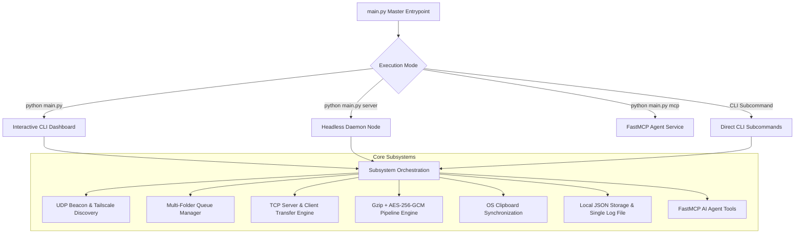
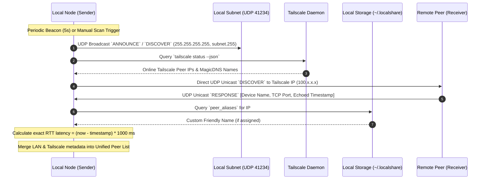
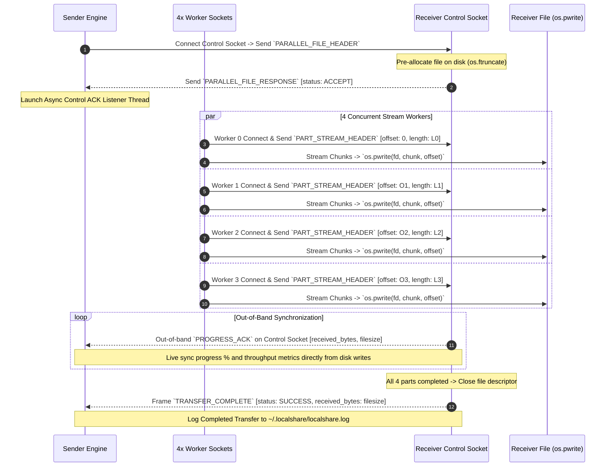
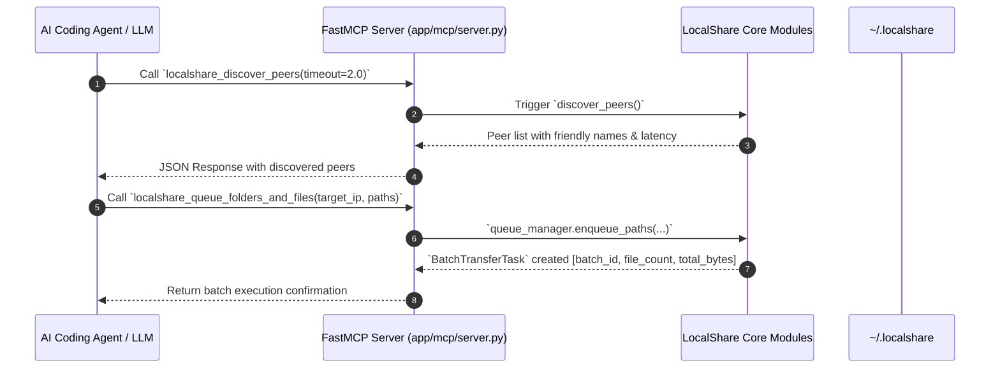

# LocalShare 2.1 🚀

High-Speed Encrypted Mesh File & Text Sharing Architecture with Virtual KVM Mouse Sharing, Multi-Folder Queueing, Streaming Gzip Compression, AES-256-GCM Encryption, Real-Time Tailscale Resolution, 4x Parallel Sockets with Asynchronous Out-of-Band ACK Synchronization, FastMCP AI Tooling, and Single-File Logging.

---

## 🏗️ Architecture

```
localshare/
├── app/
│   ├── __init__.py
│   ├── config.py              # Runtime configuration & ~/.localshare paths
│   ├── storage.py             # Local JSON config (~/.localshare/config.json) & single log file (~/.localshare/localshare.log)
│   ├── utils.py               # Networking & path security helpers
│   ├── security/              # Cryptography & Security
│   │   ├── __init__.py
│   │   └── encryption.py      # AES-256-GCM chunk encryption & key derivation
│   ├── queue/                 # Multi-Folder Queueing Subsystem
│   │   ├── __init__.py
│   │   ├── models.py          # TransferTask, BatchTransferTask, Statuses
│   │   └── manager.py         # Multi-folder expansion & concurrency scheduler
│   ├── processing/            # Stream Transformation Subsystem
│   │   ├── __init__.py
│   │   ├── engine.py          # Streaming Gzip compression & AES chunk pipeline
│   │   └── stream.py          # Socket adapters & exact byte readers
│   ├── discovery/             # LAN & Tailscale Real-time Discovery
│   │   ├── __init__.py
│   │   ├── udp_beacon.py      # UDP broadcast beacon & listener
│   │   └── tailscale.py       # Real-time Tailscale status & peer resolver
│   ├── transfer/              # TCP Binary Transfer Engine
│   │   ├── __init__.py
│   │   ├── protocol.py        # Length-prefixed framing
│   │   ├── server.py          # TCP listener & secure receiver
│   │   └── client.py          # TCP sender (multi-folder, parallel & single stream)
│   ├── sync/                  # Clipboard Sync
│   │   ├── __init__.py
│   │   └── clipboard.py       # OS clipboard helpers & text broadcast
│   ├── input/                 # Virtual KVM Subsystem (LAN Mouse & Input Sharing)
│   │   ├── __init__.py
│   │   ├── protocol.py        # 6-byte binary UDP input packet framing
│   │   ├── host.py            # Mac mouse tracking, boundary trapping & streaming
│   │   └── client.py          # Linux/Windows UDP listener & cursor injection
│   ├── mcp/                   # Model Context Protocol Service
│   │   ├── __init__.py
│   │   └── server.py          # FastMCP server & AI tools
│   └── cli/                   # Command Line Interface
│       ├── __init__.py
│       └── main.py            # Interactive terminal dashboard & CLI subcommands
├── main.py                    # Master CLI / Server / MCP entrypoint
├── setup.py                   # Package setup configuration
├── pyproject.toml             # Build system requirements
└── requirements.txt           # Minimal Python dependencies (cryptography, mcp)
```

---

## ⚡ Key Capabilities

1. **Interactive CLI & Direct Commands**: Rich terminal dashboard with numbered menus for discovering peers, batch queuing multiple folders, managing settings, resolving Tailscale nodes, viewing logs, and clipboard syncing.
2. **Multi-Folder Batch Queueing**: Send multiple directories simultaneously. Preserves folder tree structures, handles sequential execution, and tracks aggregate progress, speed (MB/s), and ETA.
3. **High-Performance 4x Parallel Sockets**: Automatically segments large unencrypted files (≥10MB) into parallel chunks over 4 dedicated TCP streams with atomic non-locking `pwrite` disk writing.
4. **Asynchronous Out-of-Band ACK Sync**: Receiver sends periodic progress ACKs over the control socket as bytes are committed to disk, guaranteeing exact real-time synchronization between sender and receiver progress bars.
5. **Streaming Gzip Compression**: High-speed on-the-fly Gzip compression (configurable levels 1–9) for rapid network throughput.
6. **End-to-End Encryption**: Authenticated AES-256-GCM chunk encryption with automatic 12-byte random nonces and 16-byte integrity tags.
7. **Real-Time Tailscale Resolution & IP Naming**: Queries Tailscale daemon status dynamically, resolves MagicDNS/IPs, and stores custom user-assigned aliases for any IP locally.
8. **Single-File Logging & Zero-Database Setup**: All persistent configuration is saved to `~/.localshare/config.json` and all activity is written to a single unified log file `~/.localshare/localshare.log`. No external databases or services required.
9. **Built-in FastMCP Service**: Dedicated Model Context Protocol server exposing LocalShare tools directly to AI coding agents.
10. **Virtual KVM Mouse Sharing**: Ultra-low-latency 6-byte binary UDP input streaming. Seamlessly move a single physical mouse between Mac and Linux/Windows displays with automatic edge-push boundary transitions.

---

## 🔄 System Architecture Flows



---

### 1. 🌐 Peer Discovery & Mesh Resolution Flow

LocalShare maintains real-time mesh awareness across both local subnet broadcasts and remote Tailscale overlay networks.



---

### 2. ⚡ High-Throughput 4x Parallel Sockets with Out-of-Band ACK Sync

For files $\ge 10\text{ MB}$, LocalShare accelerates transfer across 4 parallel TCP worker connections plus 1 control connection:



---

### 3. 🤖 FastMCP AI Agent Tool Execution

LocalShare embeds a full FastMCP server for autonomous AI agent control:



**Available MCP Tools**:
- `localshare_discover_peers`: Discover active LAN & Tailscale peers.
- `localshare_get_tailscale_status`: Query real-time Tailscale network diagnostics.
- `localshare_queue_folders_and_files`: Queue multiple folders and files simultaneously.
- `localshare_get_queue_status`: Query active, queued, and completed transfer batches.
- `localshare_send_text`: Share text snippet or broadcast to all mesh peers.
- `localshare_set_peer_name`: Store custom friendly name for an IP.
- `localshare_get_settings` / `localshare_update_settings`: Manage runtime configuration.
- `localshare_generate_encryption_key`: Generate a cryptographically secure AES-256 key.

---

## 🚀 Quickstart & Usage

### 1. One-Line Installation (Linux / macOS / Windows)
Install the latest release with a single command:
```bash
curl -sSL https://raw.githubusercontent.com/krishnakanthpathi/localshare/master/install.sh | bash
```
*Or install the pre-built wheel directly:*
```bash
pip install https://raw.githubusercontent.com/krishnakanthpathi/localshare/master/dist/localshare-2.1.0-py3-none-any.whl
```

### 2. Virtual KVM (Share Single Mouse Across Computers)
Use your Mac's mouse seamlessly across your Linux laptop or Windows machine over LAN:

**On your Linux laptop (Receiver / Client):**
```bash
localshare mouse client
```

**On your Mac (Host / Controller):**
```bash
localshare mouse host <LINUX_IP>
```
*(Leave out `<LINUX_IP>` to automatically scan and pick your discovered peer).*
* **Enter Remote**: Push your cursor against the **right edge** of your Mac screen.
* **Return to Local**: Push your cursor against the **left edge** of your Linux screen.
* **Emergency Escape**: Press `ESC` on your host keyboard anytime to immediately break remote lock.

### 3. Run Interactive Terminal Dashboard
```bash
localshare
# or: python main.py
```

### 4. Direct CLI Commands
```bash
# Scan for active peers on LAN & Tailscale
localshare scan

# Send multiple files and folders in batch
localshare send /path/to/file.mp4 /path/to/folder --target 192.168.1.50

# Assign custom friendly name to IP
localshare alias 100.105.203.102 "Work-Laptop"

# Share clipboard or text snippet
localshare text "Hello LocalShare!" --target 192.168.1.50

# View unified transfer and event logs
localshare logs

# Run headless server
localshare server

# Run FastMCP service for AI agents
localshare mcp
```
```
