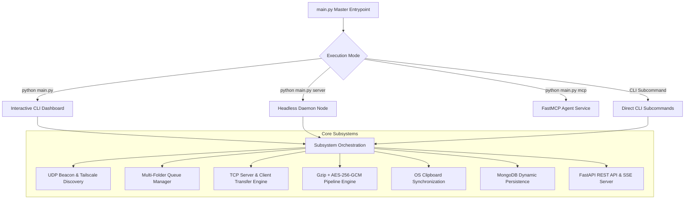
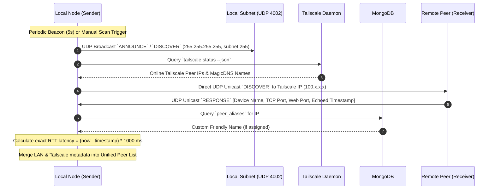
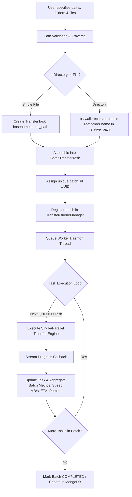
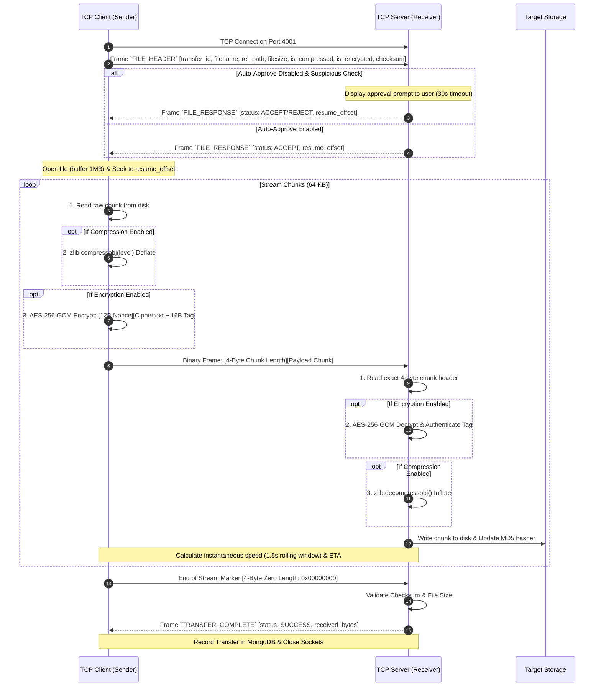
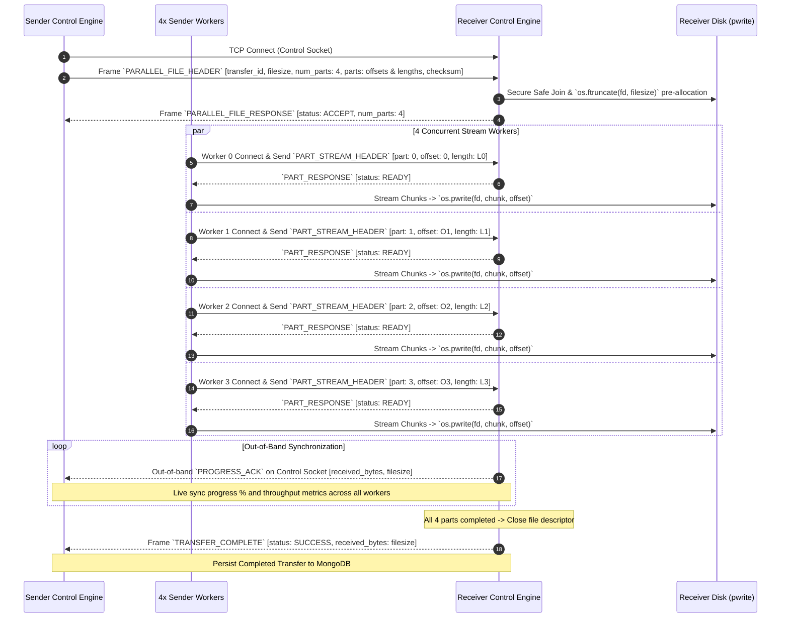
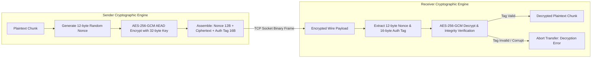
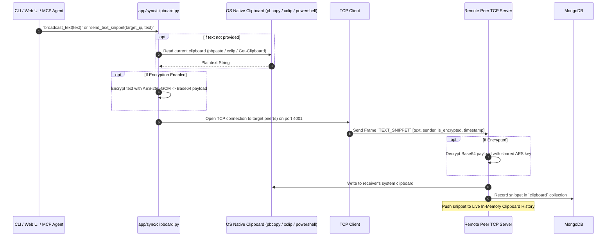
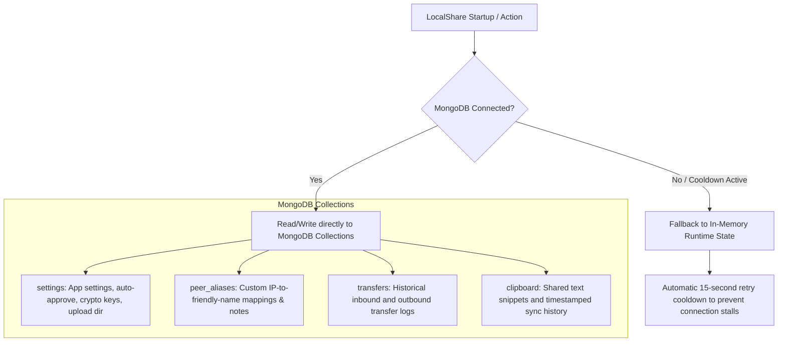
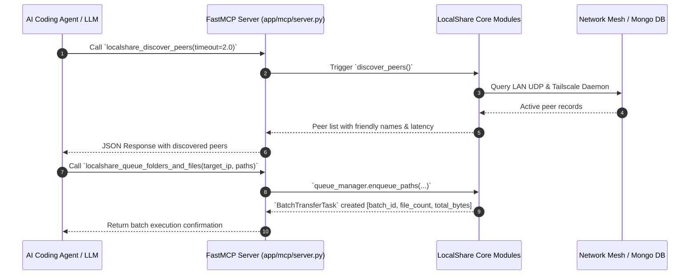

# LocalShare 2.0 🚀

High-Speed Encrypted Mesh File & Text Sharing Architecture with Multi-Folder Queueing, Streaming Gzip Compression, AES-256-GCM Encryption, Real-Time Tailscale Resolution, 4x Parallel Sockets, FastMCP AI Tooling, and MongoDB Configuration Persistence.

---

## 🏗️ Architecture

```
localshare/
├── app/
│   ├── __init__.py
│   ├── config.py              # Runtime settings & state (no .env files)
│   ├── utils.py               # Networking, path security, QR codes
│   ├── db/                    # MongoDB Persistence Layer
│   │   ├── __init__.py
│   │   └── mongo.py           # Settings, peer aliases, transfers & clipboard
│   ├── security/              # Cryptography & Security
│   │   ├── __init__.py
│   │   └── encryption.py      # AES-256-GCM chunk encryption & key derivation
│   ├── queue/                 # Multi-Folder Queueing Subsystem
│   │   ├── __init__.py
│   │   ├── models.py          # TransferTask, BatchTransferTask, Statuses
│   │   └── manager.py         # Multi-folder expansion & concurrency scheduler
│   ├── processing/            # Processing Subsystem
│   │   ├── __init__.py
│   │   ├── engine.py          # Streaming Gzip compression & AES chunk pipeline
│   │   └── stream.py          # Socket adapters & exact byte readers
│   ├── discovery/             # LAN & Tailscale Real-time Discovery
│   │   ├── __init__.py
│   │   ├── udp_beacon.py      # UDP broadcast beacon & listener
│   │   └── tailscale.py       # Real-time Tailscale status & peer resolver
│   ├── transfer/              # TCP Binary Transfer Engine
│   │   ├── __init__.py
│   │   ├── protocol.py        # Length-prefixed framing
│   │   ├── server.py          # TCP listener & secure receiver
│   │   └── client.py          # TCP sender (multi-folder, parallel & single stream)
│   ├── sync/                  # Clipboard Sync
│   │   ├── __init__.py
│   │   └── clipboard.py       # OS clipboard helpers & text broadcast
│   ├── api/                   # Web API & Settings Endpoints
│   │   ├── __init__.py
│   │   ├── routes.py          # REST endpoints (/api/settings, /api/queue, etc.)
│   │   └── server.py          # FastAPI app factory & server runner
│   ├── mcp/                   # Model Context Protocol Service
│   │   ├── __init__.py
│   │   ├── config.py          # MCP service configuration
│   │   └── server.py          # FastMCP server & tools
│   └── cli/                   # Command Line Interface
│       ├── __init__.py
│       └── main.py            # Rich interactive terminal dashboard & commands
├── main.py                    # Master CLI / Server / MCP entrypoint
├── setup.py                   # Package setup configuration
├── pyproject.toml             # Build system requirements
└── requirements.txt           # Python dependencies
```

---

## ⚡ Key Capabilities

1. **Focus on Interactive CLI**: Rich, colorful terminal dashboard with numbered menus for discovering peers, batch queuing multiple folders, managing settings, resolving Tailscale nodes, and clipboard syncing.
2. **Multi-Folder Batch Queueing**: Send multiple directories simultaneously. Preserves folder tree structures, handles sequential/parallel execution, and tracks aggregate progress, speed (MB/s), and ETA.
3. **High-Performance 4x Parallel Sockets**: Automatically segments large unencrypted files (≥10MB) into parallel chunks over 4 dedicated TCP streams with atomic non-locking `pwrite` disk writing.
4. **Streaming Gzip Compression**: High-speed on-the-fly Gzip compression (configurable levels 1–9) for rapid network throughput.
5. **End-to-End Encryption**: Authenticated AES-256-GCM chunk encryption with automatic 12-byte random nonces and 16-byte integrity tags.
6. **Real-Time Tailscale Resolution & IP Naming**: Queries Tailscale daemon status dynamically, resolves MagicDNS/IPs, and stores custom user-assigned aliases for any IP in MongoDB.
7. **MongoDB Persistence & Settings Panel**: Dynamic configuration storage in MongoDB (`pymongo`) without `.env` files. Includes interactive CLI settings editor and `/api/settings` REST endpoints.
8. **Clean Absolute Imports**: Strict `from app.xxx import yyy` references with zero `try/except` import fallback blocks.
9. **Built-in FastMCP Service**: Dedicated Model Context Protocol server exposing LocalShare tools directly to AI agents.

---

## 🔄 Complete End-to-End System Flows

LocalShare coordinates multiple asynchronous subsystems across networking, cryptography, background queue scheduling, storage persistence, and agent interfaces. Below are the complete architectural and operational data flows.



---

### 1. 🌐 Peer Discovery & Mesh Resolution Flow

LocalShare maintains real-time mesh awareness across both local subnet broadcasts and remote Tailscale overlay networks.



**Discovery Details**:
- **Protocol**: UDP datagrams on port `4002` with JSON payloads (`DISCOVER`, `ANNOUNCE`, `RESPONSE`).
- **Precision Latency**: Echoed timestamps allow exact single-clock RTT calculation without clock skew.
- **Peer Enrichment**: IPs matching `100.x.x.x` or reported by the local Tailscale daemon receive OS metadata, hostname resolution, and Tailscale tags. Custom MongoDB aliases take highest display precedence.

---

### 2. 📦 Multi-Folder Batch Ingestion & Queue Flow

When sending files or folder trees, LocalShare preserves directory hierarchies and creates structured batch tasks.



**Folder Preservation Example**:
- Specifying `/data/project/` containing `src/main.py` and `docs/readme.txt` enqueues tasks with relative paths `project/src/main.py` and `project/docs/readme.txt`. The receiver creates the identical directory structure under its configured upload directory.

---

### 3. ⚡ Single-Stream Transfer & Processing Pipeline Flow

For single files or streams with encryption/compression active, data passes through a 4-byte length-prefixed streaming pipeline.



---

### 4. 🚀 4x Multi-Socket Parallel Streaming Architecture

Large unencrypted files (≥10MB) automatically activate 4 concurrent TCP worker sockets for maximum throughput over Gigabit LAN and high-speed mesh networks.



**Key Parallel Architecture Features**:
- **Atomic Zero-Lock Disk Writes**: `os.pwrite(fd, chunk, offset)` writes directly to the pre-allocated file at exact byte offsets without file-lock contention across threads.
- **Out-of-Band Control Protocol**: Live progress updates and checksum confirmations travel over a dedicated control socket, keeping the UI dashboard in sync.

---

### 5. 🛡️ Security, Encryption & Integrity Verification Flow

LocalShare implements authenticated symmetric encryption and strict path sandboxing.



**Security Guarantees**:
- **AES-256-GCM Authenticated Encryption**: Every chunk has a distinct 96-bit random nonce (`os.urandom(12)`) and a 128-bit authentication tag ensuring confidentiality and tamper resistance.
- **Key Derivation**: Passphrases automatically derive 256-bit keys via `PBKDF2HMAC` with `SHA256` and 100,000 iterations.
- **Directory Traversal Protection**: All paths are validated via `safe_join()` to prevent `../` path escape vulnerabilities. Suspicious file extensions (`.sh`, `.bat`, `.exe`, etc.) trigger security alerts.

---

### 6. 📋 Clipboard Synchronization & Text Broadcast Flow

LocalShare seamlessly synchronizes text and clipboard contents across platforms.



---

### 7. 🍃 MongoDB Dynamic Persistence & Configuration Flow

LocalShare uses MongoDB for zero-configuration persistence without `.env` files, featuring graceful offline caching and connection throttling.



---

### 8. 🤖 FastMCP AI Agent Tool Execution Flow

LocalShare embeds a full FastMCP (Model Context Protocol) server for autonomous AI agent control.



**Available MCP Tools**:
- `localshare_discover_peers`: Discover active LAN & Tailscale peers.
- `localshare_get_tailscale_status`: Query real-time Tailscale network diagnostics.
- `localshare_queue_folders_and_files`: Queue multiple folders and files simultaneously.
- `localshare_get_queue_status`: Query active, queued, and completed transfer batches.
- `localshare_send_text`: Share text snippet or broadcast to all mesh peers.
- `localshare_set_peer_name`: Store custom friendly name for an IP in MongoDB.
- `localshare_get_settings` / `localshare_update_settings`: Manage runtime configuration.
- `localshare_generate_encryption_key`: Generate a cryptographically secure AES-256 key.

---

### 9. 🌐 REST API & Real-Time SSE Event Stream Flow

The built-in FastAPI web server exposes a REST interface and real-time Server-Sent Events (SSE) stream for web clients, scripts, and mobile browsers.

```mermaid
flowchart TD
    Client[Web Browser / Mobile Client / Automation Script] --> API[FastAPI Web Server :4000]
    
    subgraph REST Endpoints
        API -->|GET /api/events| SSE[Server-Sent Events Stream: Real-Time Transfers & Batches]
        API -->|GET /api/peers| P[Discover Active LAN & Tailscale Peers]
        API -->|GET, POST /api/settings| S[Settings & Configuration Manager]
        API -->|GET, POST /api/settings/peers| A[Custom Peer Aliases & Notes]
        API -->|GET, POST /api/queue/*| Q[Multi-Folder Queue: Enqueue, Pause, Resume, Cancel]
        API -->|GET, POST /api/transfers| T[Active Transfers & MongoDB History]
        API -->|GET, POST /api/clipboard| C[Clipboard Read, Write & Network Broadcast]
        API -->|POST /api/upload| U[HTTP Multipart File Upload]
        API -->|GET /api/download/{path}| D[File & Compressed Folder Download]
        API -->|GET /api/qrcode| QR[SVG QR Code for Instant Mobile Pairing]
    end
```

---

## 🚀 Getting Started

### Installation
```bash
pip install -r requirements.txt
```

### Launch Interactive CLI Dashboard
```bash
python main.py
```

### CLI Subcommands
```bash
# Scan LAN and Tailscale mesh for peers
python main.py scan

# Send multiple folders and files to a peer
python main.py send /path/to/folder1 /path/to/folder2 /path/to/file.pdf --target 100.64.0.5

# Assign a custom friendly name to an IP in MongoDB
python main.py alias 100.64.0.5 "Living Room Mac" --notes "Tailscale node"

# View Tailscale mesh status
python main.py tailscale

# Broadcast or send a text snippet
python main.py text "Hello LocalShare!" --target 192.168.1.50

# Run headless server
python main.py server

# Run FastMCP service for AI agents
python main.py mcp
```

